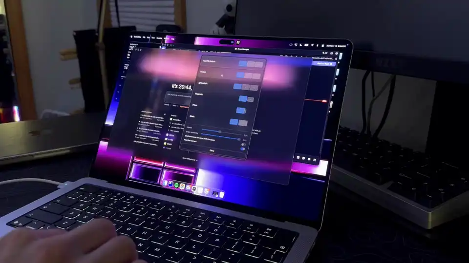

# Interspace

Custom transitions for switching between desktops (Spaces) on macOS.



macOS has one animation for a three-finger swipe between desktops, and no setting for it. Interspace replaces that animation with one you choose, follows your fingers while you swipe, and finishes faster.

## Install

Interspace is built on your Mac from this source. You need macOS 14 or newer and the Xcode Command Line Tools (the installer asks for them if they are missing).

```sh
curl -fsSL https://raw.githubusercontent.com/cnrad/interspace/main/scripts/install.sh | bash
```

Or ask your coding agent:

> Install Interspace from https://github.com/cnrad/interspace. Clone it, read `scripts/install.sh` before you run it, then run it. When it finishes, tell me which two permissions to turn on in System Settings and where.

The script gets the source into `~/.interspace`, builds it, makes a signing identity for your Mac, and puts `Interspace.app` in `/Applications`. Run the same command again to update.

### Permissions

Only you can do this part. Allow Interspace in System Settings > Privacy & Security, in two places:

| Permission | Why |
|---|---|
| Accessibility | To take the swipe before macOS does, and to tell the Dock to switch spaces |
| Screen & System Audio Recording | To take the pictures of your desktops that the transition shows |

Then choose **Relaunch Interspace** in its menu bar menu. Until both are allowed, Interspace does nothing and the normal macOS swipe works as before.

Interspace sends nothing off your Mac. It has no network code.

### Uninstall

```sh
~/.interspace/scripts/uninstall.sh
```

## Transitions

| Name | What it does |
|---|---|
| macOS Default | The standard transition. Interspace stays out of the way. |
| Instant | No animation. The next space is there at once. |
| Lightweight | The screens slide and pull back slightly. |
| Magnetic | The screen shrinks and moves aside. The next one moves in and grows. |
| Prism | The spaces are the sides of a prism that turns. |
| Stack | A pile of screens. One slides on top, or off again. |

Open **Settings…** from the menu bar icon to choose one. Each has a small moving preview. The same window has:

- **Speed:** how fast the transition finishes after you let go.
- **Swipe sensitivity:** how far the screens move for the same finger travel. Set high, one swipe can pass several spaces.
- **Dock and menu bar move with the space:** on, they are part of each screen. Off, they stay in place as in macOS.
- **Rounded corners:** each screen gets the corner shape of your display.

The macOS keyboard shortcuts for "move left a space" and "move right a space" use the chosen transition too.

## How it works

Interspace does not change macOS. The Dock still does every space switch.

1. An event tap takes the system's swipe events before the Dock sees them, so the built-in animation never starts.
2. Raw finger positions from the trackpad drive a full-screen overlay that shows pictures of your desktops.
3. When you let go, Interspace posts a synthetic swipe that the Dock completes in about one frame, below the overlay.
4. The overlay finishes its own animation and is removed when the real desktop below is ready.

Quit Interspace and the normal macOS behaviour is back at once.

## Limits

- **Private macOS behaviour.** The trackpad data, the synthetic swipe, the list of spaces and one of the screen captures are not public API. A macOS update can break any of them. It is developed and tested on macOS 27 only.
- **No Mac App Store, no notarized download.** That is why it is built from source.
- **A short screen freeze at launch.** macOS only draws the active space, so Interspace visits each space once behind a frozen picture to capture it. It takes about a second.
- **A new desktop** shows your wallpaper the first time you swipe to it. Use **Capture All Spaces Again** in the menu to avoid that.
- **Mission Control.** A swipe while Mission Control is open is not handled well.
- **macOS asks again for Screen Recording** from time to time. That is system policy for every app that captures the screen.

## Development

```sh
scripts/setup-signing.sh   # one time: a local signing identity, so permissions survive rebuilds
scripts/bundle.sh          # builds build/Interspace.app
```

Every tuning value is in `Sources/Interspace/Config.swift`. The math of each transition is in `TransitionMath.swift`, and both the real transition and its preview in the settings window use it.

`perf/` is a benchmark build of the same sources.

## Credits

The synthetic swipe and its macOS 27 event format come from [InstantSpaceSwitcher](https://github.com/jurplel/InstantSpaceSwitcher) by jurplel (MIT).

## License

MIT. See [LICENSE](LICENSE).
